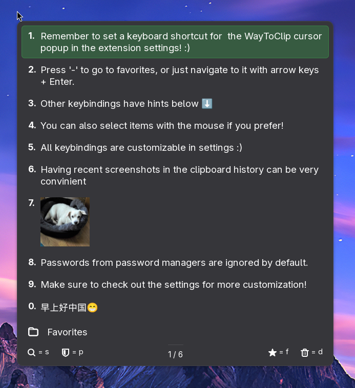

# WayToClip

Keyboard-driven clipboard manager for GNOME, Wayland. Press a shortcut, a popup opens at your cursor, press 1-9 to paste.

Inspired by the classic clipboard manager for Windows [CLCL](https://nakka.com/soft/clcl/index_eng.html). For years,
I never found a Linux alternative that mirrored the keyboard-focused, productive way of working like with CLCL, hence
this project was made.

Monitoring logic based on [Clipboard Indicator](https://github.com/Tudmotu/gnome-shell-extension-clipboard-indicator).
Big thanks to the author and contributors to that project! (This was originally a fork, but has since been deforked as
to many changes was made to justify keeping the upstream).



Clipboard history stays on your machine. Nothing is sent anywhere.

## Install

From source:

```bash
make install
```

Then log out and back in (or restart GNOME Shell), and enable it in Extension Manager.

Requires GNOME Shell 46-51.

## Setup

No shortcut is set by default. Go to the extension settings and set one for "Toggle the cursor popup", e.g. Alt+X.

## Use

Open the popup with your shortcut, then:

- `1-0` - paste item by number
- `Up/Down` - move selection
- `Tab` / `Right` - next page, `Shift+Tab` / `Left` - previous page
- `Enter` - paste selected item
- `s` - search, (then `Alt+c` to match case, `Alt+r` for regex)
- `f` - mark as favorite
- `-` - toggle favorites view
- `d` - delete selected item
- `p` - toggle private mode (stops recording)
- `Esc` - close

Selecting an item copies it and pastes it at the cursor. Turn off auto-paste in settings if you just want to copy.

All popup keys can be changed in settings.

## Development

```bash
make check          # run tests (gjs, headless)
make lint           # eslint + import and line-length checks
make install        # build + copy to ~/.local/share/gnome-shell/extensions/
make nested-session # open a nested GNOME Shell to test without relogging (requires some dev packages to run)
make bundle         # build bundle.zip for extensions.gnome.org
```

### Architecture

This project follows domain-driven design (DDD): each folder under `src/` is one domain with its own logic, and `wayToClipController.js` wires them together.

- `clipboard/` - watches St.Clipboard, filters secrets/excluded apps
- `history/` - in-memory store, disk cache, clear timers
- `cursorPopup/` - popup UI, selection, search, local shortcuts
- `paste/` - auto-paste via synthetic keypress, terminal handling
- `panel/` - top bar button and dialogs
- `settings/` - GSettings wrapper and global shortcuts
- `common/` - constants, logging, translations
- `prefs/` - settings UI, kept separate (shell and prefs run in different processes)

### Translations

User-visible strings go through `_('...')`. When you add or change one:

```bash
make update-po-files  # xgettext -> waytoclip.pot, merge into each locale/*/LC_MESSAGES/waytoclip.po
```

Then fill in the `msgstr` entries in the `.po` files and rebuild:

```bash
make all  # rebuilds src/common/translations.js + compiled .mo files
```

Two generated outputs, both needed:

- `src/common/translations.js` - bundled catalogs for the language override setting in prefs. Committed, so regenerate and commit it.
- `locale/*/LC_MESSAGES/waytoclip.mo` - compiled files for native gettext (system language). Rebuilt by `make all` / `make install`.

To add a new language: copy an existing `locale/<lang>/LC_MESSAGES/waytoclip.po`, translate the `msgstr` entries, and add its label to `LANGUAGE_LABELS` in `src/common/i18n.js`.
